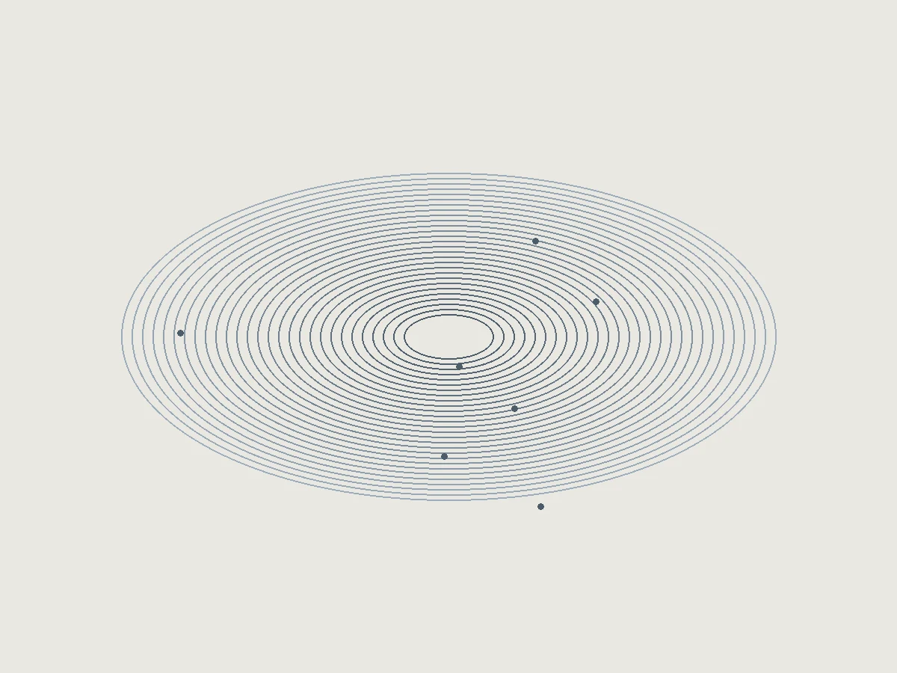

# 昔日烬 · 枢

个人作品集与音乐网站的公开源码，使用 Astro、React、TypeScript 和 Motion

主名「昔日烬」，当前副名「枢」，取北斗七星天枢之意；音乐身份「殉乐」，编程身份「ENS」

## 页面与交互

- 首页：全屏影像、混合字体和精选项目入口
- 作品集：16 组技术项目、分类筛选、独立案例和 GitHub 链接
- 音乐：9 首原创音乐的曲目资料、试听组件、进度与音量控制
- 动态谱：动态鼓谱与伴奏的视频播放器
- 图片保持比例，通过 `object-fit: cover` 裁剪；尊重减少动态效果的系统偏好



## 运行

需要 Node.js 22.12+ 和 npm

```sh
npm ci
npm run dev
npm run check
npm run build
```

开发地址：<http://127.0.0.1:4321/>，静态构建输出到 `dist/`

## 音乐与媒体

此仓库公开完整网站代码与曲目文案，不分发音频、动态谱视频、原始封面或真人照片，所有随仓库提供的位图都是程序生成的抽象图

播放器读取 `src/data/music.ts` 与 `src/data/scores.ts` 中的资源地址。运行有声版本时，将有权使用的媒体放入被 Git 忽略的 `public/media/audio/`、`public/media/scores/`，或将 `src` 改为自己的 HTTPS 媒体地址；资源缺失时播放器显示错误反馈。音频、视频文件不受代码许可证授权

界面没有下载按钮。试听通过浏览器传输媒体，不提供防复制保证

## 内容与仓库

- `src/data/projects.ts`：项目资料、边界和仓库名
- `src/data/music.ts`：原创音乐清单
- `src/data/scores.ts`：动态谱清单
- `src/components/`：播放器、作品筛选、首页视觉
- `scripts/sync-repositories.mjs`：通过本机 `gh` 登录同步仓库链接，不将令牌写入网站

见闻线上入口：<https://ai4kid.cn/szx/>

```sh
npm run sync:repos
```

同步命令需要 GitHub CLI。公开版不包含个人本地路径、原始材料说明、私有仓库历史和付费模板提示词

## 设计来源与许可

页面参考用户提供的 MotionSites Creative Designer Portfolio、DJ ZakDerdan 与 Atrium MTL 设计方向。MotionSites 原提示词、外部字体和外部视频均不作为本仓库的 MIT 资产重新许可；其使用遵循各提供方的条款，部署前应确认相应使用权。首页会请求 MotionSites 视频与字体 CDN，可在 `Hero.tsx`、`SiteLayout.astro` 和样式中替换为自有资源

原创实现代码与本仓库生成的抽象图片使用 [MIT License](LICENSE)。第三方库遵循各自许可证；音乐、第三方视频、字体和项目关联素材不在该授权范围内

## 验证范围

公开前执行类型检查、静态构建、敏感信息扫描和文件清单检查。未在此公开版中补齐私人媒体，不能据此宣称在线试听已部署。项目资料中的历史实验与团队作品保留各自来源边界
