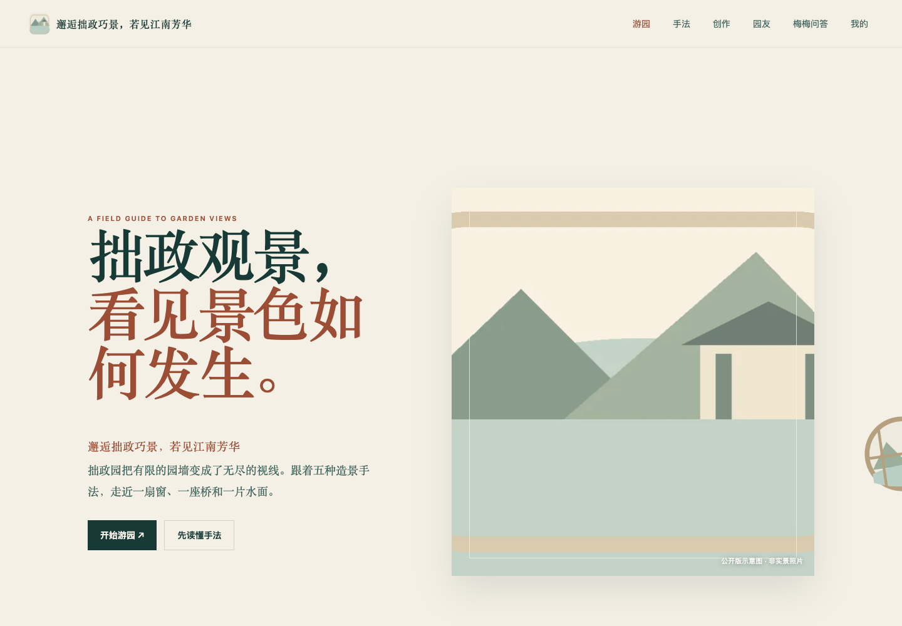
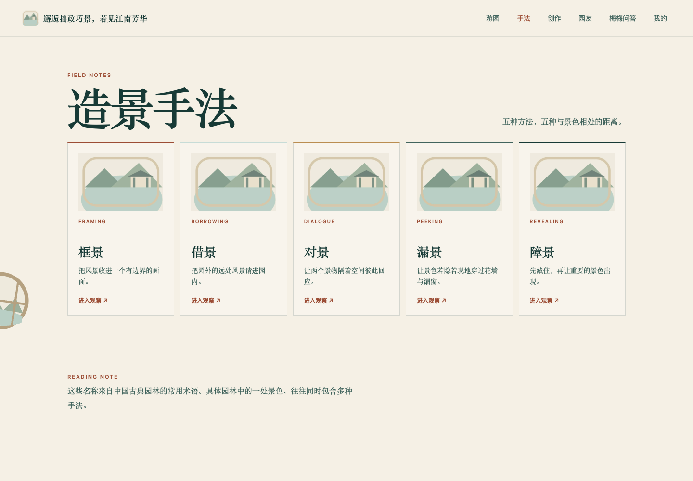
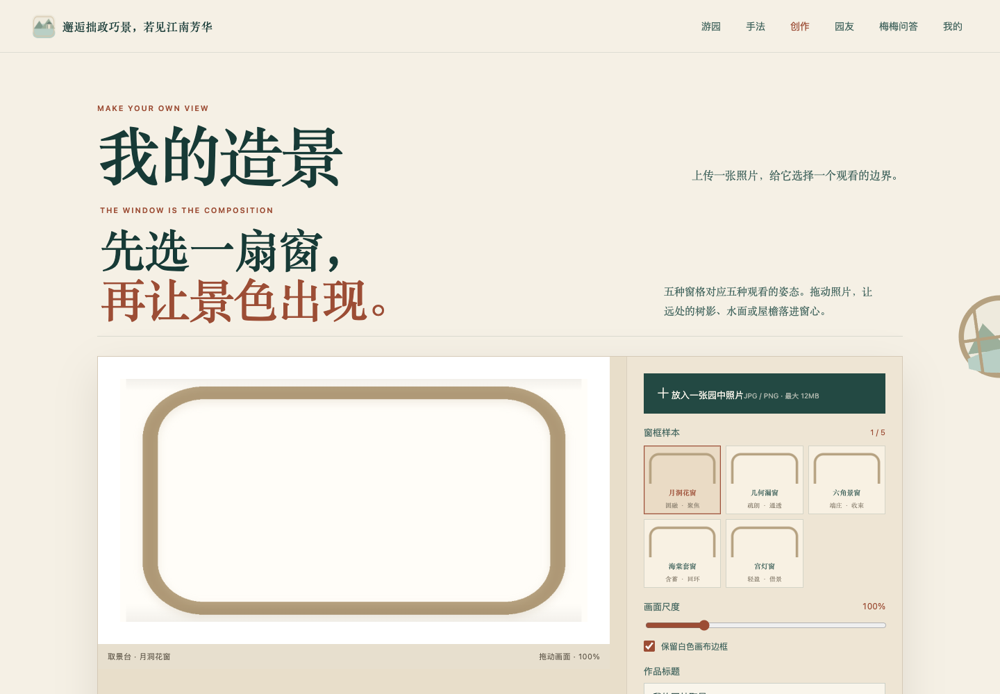

# 拙政观景 · 公开示意版

用交互网页理解拙政园的框景、借景、对景、漏景和障景。包含观察点地图、案例阅读、花窗构图创作、抽象花窗助手，以及可选的账户、园友社区与 AI 问答后端。

本版本为隐私清理后的完整应用源码：原实拍、学生作品和私人研究文档均未包含；配图和动景改为程序绘制的无人物示意，不能视作拙政园实景资料。







[观看界面演示视频](docs/media/demo.mp4)（真实公开版界面截图轮播，无音轨，不是连续操作录像）。

## 运行

要求 Node.js 20.19+ / 22.12+、Python 3.11+。

```sh
cd web
npm ci
npm run dev
```

打开终端显示的本地 URL。观察阅读和本机创作不依赖后端；账户、社区和 AI 需要另开终端：

```sh
cd backend
python3 -m venv .venv
source .venv/bin/activate
pip install -r requirements.txt
cp .env.example .env
uvicorn app.main:app --host 127.0.0.1 --port 8011
```

后端健康检查为 `http://127.0.0.1:8011/health`；Vite 将 `/api` 和 `/health` 代理到该端口。开发用本地短信验证码见 `.env.example`，仅用于开发，不发送短信。AI 需自行配置兼容接口的密钥、地址及模型。生产环境必须配置独立 SECRET_KEY 和真实短信服务。

## 架构

- `web/src`：Vue 3 单页应用、Hash 路由、Leaflet 地图、花窗 SVG 示意、Canvas 图片导出、本机作品存储。
- `backend/app`：FastAPI、SQLAlchemy/SQLite、账户与短信适配、流式 AI、社区审核与媒体接口。
- `blender`：花窗模型和动景构建脚本；需单独安装 Blender，运行主应用不需要它。
- `web/public`：公开版无人物示意资源；`docs/media` 为本版 UI 截图及视频。

## 验证与限制

```sh
cd web
npm test
npm run build
# 后端虚拟环境中，在 backend 目录执行：
python -m unittest discover -s tests
```

前端 26 项测试、后端 18 项测试及生产构建通过。浏览器检查覆盖首页、手法页和创作页。在线地图需要网络；AI 和真实短信未进行外部服务集成测试。社区初始为空，无演示真人账户。本版不附带原始研究材料、原图和历史数据库；场景配图是抽象示意。原虚拟角色 GLB 未随公开版分发，改用公开版自行绘制的抽象 SVG 花窗。

资源范围与第三方许可见 [ASSETS.md](ASSETS.md)。原创应用代码按 [MIT License](LICENSE) 开源，署名 ENS。第三方资源不在 MIT 授权范围内。
