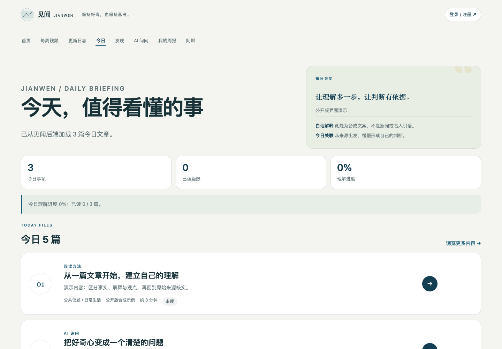
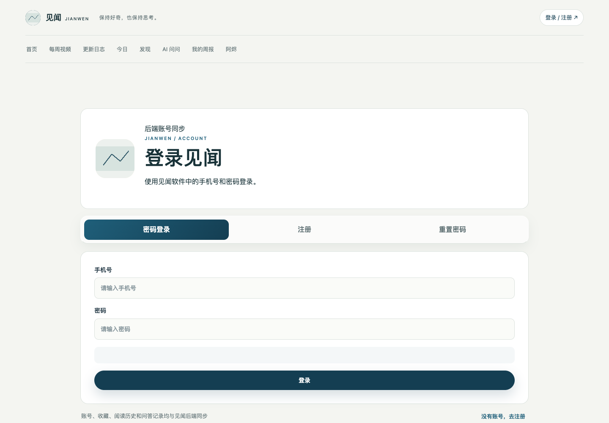

# 见闻 · 从阅读到理解

一个面向阅读、信息理解与公共议题学习的应用：把今日文章、可靠来源、AI 追问和个人阅读周报连接起来。

[在线网站](https://ai4kid.cn/szx/) · [Android 公开预览 APK](apk/jianwen-1.0.1-public-preview.apk) · [界面导览视频](docs/media/interface-tour.mp4) · [素材说明](docs/MEDIA.md)



> 上图来自本仓库真实网页界面，使用合成演示文章与全新浏览器会话；不是线上新闻截图，不含真实账号、阅读记录或真人照片。视频为这些截图组成的无声界面导览。

## 可以做什么

- **今日阅读**：文章卡片、摘要、来源、阅读进度与每日金句。
- **发现与阅读器**：主题分类、文章检索、名著章节阅读与位置同步。
- **AI 问问**：围绕文章继续追问，流式展示回答，管理提问额度。
- **阅读周报**：按周汇总阅读与提问数据，并导出长图。
- **账户与偏好**：登录注册、收藏、历史、关注主题、字号与主题设置。
- **多端实现**：Vue 3 / uni-app 客户端、独立网页与 FastAPI 后端。



## 仓库结构

```text
backend/       FastAPI、SQLAlchemy、认证、内容与阅读统计接口，以及回归测试
frontend/      Vue 3 / uni-app 页面、组件、工具、Android 配置与测试
webpage/       独立网页、阅读器、AI 对话和周报实现
docs/          真实界面截图、无声导览、复现脚本与公开说明
```

这是从原始项目整理的独立公开版，保留核心应用源码，不包含 Git 历史、服务器配置、内部交接文档、数据库、用户上传、日志、账号资料、签名材料和生产环境变量。个人介绍与角色背景已改为中性文案；编辑配图改为几何占位图。每周节目目录为空，需要自行添加具有合法使用权的内容。

## 本地启动

建议 Python 3.12+、Node.js 20+、MySQL 8。所有命令均在本仓库目录执行。

### 后端

```bash
cd backend
python3 -m venv .venv
source .venv/bin/activate
pip install -r requirements.txt
cp .env.example .env
# 编辑 .env，填写本地 MySQL 用户、密码与数据库配置
uvicorn app.main:app --host 127.0.0.1 --port 8000
```

后端会创建和初始化数据库；数据库账号需要相应权限。验证 `http://127.0.0.1:8000/health`，预期为 `{"status":"ok"}`。本仓库没有生产数据库，也不会连接原作者的数据库。

### uni-app / H5 客户端

```bash
cd frontend
npm ci
cp .env.example .env
npm run dev:h5
# 构建：npm run build:h5
```

在 `.env` 中设置 `VITE_API_BASE_URL`。Android 真机应使用你自己的 HTTPS 后端；默认网络安全配置禁止明文连接。Android 打包需要自行配置 HBuilderX / uni-app 工具链、应用标识与签名，签名密码和私钥不能进入仓库。

### 独立网页

```bash
python3 -m http.server 8765 --bind 127.0.0.1 --directory webpage
```

打开 `http://127.0.0.1:8765/jianwen/`；本地网页默认请求本机 8000 端口的后端。在线部署时同源反向代理 `/api/`、静态图片和公开目录。

## 环境变量

| 变量 | 用途 |
| --- | --- |
| `MYSQL_HOST` / `MYSQL_PORT` / `MYSQL_USER` / `MYSQL_PASSWORD` / `MYSQL_DATABASE` | 自己的数据库连接 |
| `SECRET_KEY` | 自己生成的高强度随机认证密钥 |
| `AI_API_BASE_URL` / `AI_API_KEY` / `AI_MODEL` | 兼容聊天补全接口的 AI 服务 |
| `SMS_PROVIDER` | 本地开发可用 `local`，生产必须配置真实服务 |
| `ALIYUN_DYPNS_*` | 自己的短信服务凭据与模板 |
| `CORS_ORIGINS` | 允许访问接口的前端来源 |
| `ENVIRONMENT` | 本地开发为 `development`；生产设置 `production` |
| `VITE_API_BASE_URL` | uni-app 客户端使用的 API 地址 |

`AI_API_BASE_URL` 示例域名不可直接使用。未配置 AI 服务时，相关能力无法完整工作。本地验证码仅供开发，不应在公网启用。生产环境需要设置认证密钥、真实短信服务、严格跨域来源、HTTPS、上传限制和服务端日志策略。当前网页使用浏览器存储保存会话；部署时应评估 XSS 防护与会话设计。

## Android 公开预览

[下载见闻 1.0.1 公开预览 APK](https://github.com/UzimakeNarutoszx/personal-website-oss/releases/download/public-editions-2026-11-01/jianwen-1.0.1-public-preview.apk)（约 18.7 MiB）。这是对原始 Android 包进行脱敏、替换展示素材后，以全新通用证书重新签名的预览包；不是从本仓库执行原生完整编译产生的正式版。

- 已移除包内构建签名配置、开发者字段、原渠道账号标识与原服务器地址；宣传片改为本仓库无声界面导览。
- APK 对齐及签名验证通过，DEX、原生库和其余归档文件进行了字符串检查；未进行真机或模拟器安装验证。
- 后端默认指向不可用的示例域名 `https://api.example.invalid`，因此在线内容、账号登录与 AI 请求默认不可用；此包用于检查客户端外观与打包产物。完整使用应按源码配置自己的服务并重新构建。
- 包名仍为 `com.jianwen.app`，签名与原始版本不同；安装前可能需要卸载原版，卸载会清除本机应用数据，请先自行备份。原始包不包含在公开版中。

SHA-256：`158e03e5c93dc0cc66311f0b76f8b2165b7e8e3c00ec15a7244919380bf83df9`。详见 [Android 预览说明](docs/ANDROID_PREVIEW.md)。

## 测试与截图复现

```bash
cd backend
pip install -r requirements-dev.txt
python -m pytest -q tests

cd ../frontend
node --test tests/*.test.mjs
```

截图复现说明见 [素材说明](docs/MEDIA.md)。公开版已通过后端 177 项测试与 98 项子测试、前端 12 项测试、H5 生产构建；网页测试从仓库根目录运行 `node --test webpage/tests/*.test.cjs webpage/tests/*.test.mjs`，13 项通过，2 项原始节目素材检查因公开版不含节目而明确跳过。完整在线服务、真实短信和 Android 安装仍需使用自己的部署环境验证。

依赖扫描提示当前前端锁文件中存在 35 项已知依赖告警（23 高、4 中、8 低）。这些告警需要结合 uni-app 兼容性单独升级验证，不能将通过构建或测试等同于生产安全认证。

## 许可与内容边界

自有源码采用 [MIT License](LICENSE)。第三方依赖、库文件、字体、平台运行时及内容资料各自遵循原许可证，见 [第三方说明](THIRD_PARTY_NOTICES.md)。MIT 不授予第三方文章、名著译文、新闻素材或商标的权利；接入和分发内容前请单独核对来源与授权。AI 回答可能不准确，应回到原始来源核实。
